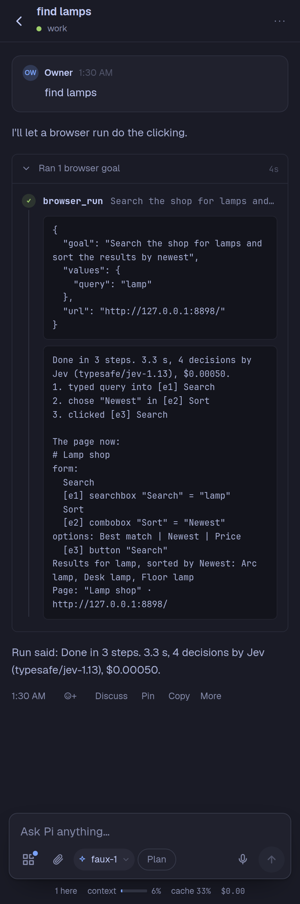

# Browser runs for Pi Pocket

Pi gives the browser one goal and the values it may type, and a run model carries it out a step at a time, without Pi, until it is done or has a reason to stop. A drop-in extension for [Pi Pocket](https://github.com/TannerMidd/pi-pocket) 0.22.0 or later, from the gallery.



## What it does

One tool, `browser_run`:

```json
{
    "goal": "Search the shop for lamps and sort the results by newest",
    "values": { "query": "lamp" },
    "url": "shop.example",
    "max_steps": 25
}
```

Each step reads the session's page (its controls and its text), asks the **run model** one set of typed questions (which operation, which target for each, which supplied value goes into a field, did the last step work, is the goal visibly done), acts on the target it chose among the offered ones, and sees what changed. It stops with a reason Pi can act on:

| Reason            | When                                                                      |
| ----------------- | ------------------------------------------------------------------------- |
| `done`            | The model says done, and "is the goal visibly done" is 0.6 or more.       |
| `unverified_done` | The model says done, but the page does not show it.                       |
| `blocked`         | No offered control can move the goal on.                                  |
| `needs_value`     | A field needs a value that is not in `values`. The run never invents one. |
| `stuck_loop`      | Three steps in a row changed nothing.                                     |
| `budget`          | `max_steps` (default 25) or 180 seconds.                                  |
| `spend_limit`     | A spend limit of the session's was reached.                               |
| `decision_error`  | The run model refused, or answered with a choice it was not offered.      |

Pi gets a short report (how it ended, the steps, the time, the decisions and their cost) and the page as it is. A run is faster and much cheaper than Pi doing each step: each step is one small decision request, not a turn of the main model with the whole conversation. On a small shop, with Jev: 3 steps, 3.3 s, $0.0005. On en.wikipedia.org ("open the article on Ha Long Bay"): 2 steps, 3.6 s, $0.0012.

A password field is never offered for typing. Pi signs in first (for example with the Browser sign-in extension), then runs again.

## The run model

The owner chooses it, with the command `/browser-run-model` (the owner only; Pi cannot choose: the tool has no model parameter). It is kept in Pi Pocket's data folder, in `browser-runs.json`.

- **`session`** (the default): the session's own model answers the questions as JSON.
- **`typesafe/jev-1.13`**: Jev, TypeSafe's decision model, through OpenRouter's decisions route.

**What it reads, and where it sends it.** With Jev, the extension reads the owner's **OpenRouter sign-in** (Pi's own, in Providers), and sends each step's questions, the goal, the supplied values, and the page's controls and text to `https://openrouter.ai/api/alpha/decisions`. With `session`, it sends them to the session's model, as Pi's own requests go. Nothing else leaves the server. What a run costs goes to the session's spend, as the tool's usage.

## Credits

The loop, the questions, and their instruction texts follow [browser-use/jev-ultrafast](https://github.com/browser-use/jev-ultrafast) (MIT, Copyright (c) 2026 Browser Use) and [brnyxx/jev-ra](https://github.com/brnyxx/jev-ra) (MIT).

## Install

From the gallery: Menu → Extensions → **Discover** → Browser runs → Install, then turn it on. Or copy `browser-runs.ts` and `browser-runs.js` into `~/.pi-pocket/extensions/`. Pi Pocket's Browser module must be on.

## Develop

Tests run against a Pi Pocket checkout (0.22.0 or later) with its packages installed, on Node 22; the run on a real page needs a Chromium-based browser on the machine:

```sh
ln -s ../pi-pocket/node_modules node_modules
ln -s ../pi-pocket/types/pocket.d.ts _pocket.d.ts
npx tsc -p .
POCKET_DIR=../pi-pocket node --test browser-runs.test.ts
```

## License

MIT
